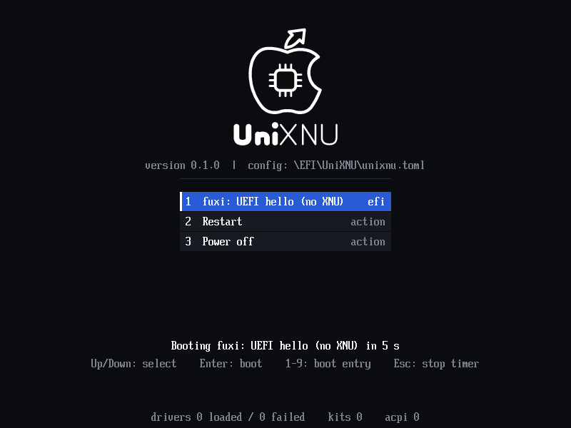

# 在 Linux 上本地构建（无 root、无 Mac）

这条路线只能做 **UEFI 固件 + UniXNU 菜单** 的镜像（workflow 的 `uefi` 模式）。
内核、payload、userdata 仍然需要 macOS（Xcode / hdiutil）。

下面是在 Ubuntu 22.04、**没有 root** 的环境里实测通过的步骤。工作目录是
`~/unixnu`，工具装进 `~/unixnu/.tools`。

## 1. 准备

```sh
cd ~/unixnu
mkdir -p .tools
git clone https://github.com/UniXNU/UniXNU.git
git clone https://github.com/hanzi123-bilp/unixnu-fuxi.git
git clone -b fuxi https://github.com/hanzi123-bilp/uefi-fuxi.git
```

### Python 3.13（`unixnu` 需要 `tomllib`）

```sh
export UV_INSTALL_DIR=$PWD/.tools/bin UV_PYTHON_INSTALL_DIR=$PWD/.tools/python
export UV_CACHE_DIR=$PWD/.tools/uv-cache
curl -LsSf https://astral.sh/uv/install.sh | sh
.tools/bin/uv python install 3.13
PY=$PWD/.tools/python/cpython-3.13-linux-x86_64-gnu/bin/python3.13
```

### LLVM 18（EDK2 的 CLANGPDB 工具链）

官方 18.1.8 的 Linux 包是 Ubuntu 18.04 构建，需要 `libtinfo.so.5`：

```sh
cd .tools
curl -LO https://github.com/llvm/llvm-project/releases/download/llvmorg-18.1.8/clang+llvm-18.1.8-x86_64-linux-gnu-ubuntu-18.04.tar.xz
tar xf clang+llvm-18.1.8-x86_64-linux-gnu-ubuntu-18.04.tar.xz
mv clang+llvm-18.1.8-x86_64-linux-gnu-ubuntu-18.04 llvm18

# libtinfo5：从 Ubuntu 池里取，解包即可，不需要 root
curl -LO http://archive.ubuntu.com/ubuntu/pool/main/n/ncurses/libtinfo5_6.1-1ubuntu1.18.04.1_amd64.deb
dpkg-deb -x libtinfo5_*.deb tinfo5
```

### uuid 头文件（EDK2 BaseTools 的 GenFv 需要）

```sh
curl -LO http://archive.ubuntu.com/ubuntu/pool/main/u/util-linux/uuid-dev_2.37.2-4ubuntu3.6_amd64.deb
dpkg-deb -x uuid-dev_*.deb uuiddev
mkdir -p uuiddev/usr/lib/x86_64-linux-gnu
ln -sf /usr/lib/x86_64-linux-gnu/libuuid.so.1.3.0 uuiddev/usr/lib/x86_64-linux-gnu/libuuid.so
```

### mtools（打包 payload 要用；UEFI-only 不写 payload 也需要它 import）

```sh
curl -LO https://mirrors.tuna.tsinghua.edu.cn/gnu/mtools/mtools-4.0.43.tar.gz
tar xf mtools-4.0.43.tar.gz && cd mtools-4.0.43
./configure --prefix=$PWD/../mtools && make -j8 && make install
```

### 环境变量（每个新 shell 都要设）

```sh
cd ~/unixnu
export PATH=$PWD/.tools/llvm18/bin:$PWD/.tools/mtools/bin:$PATH
export LD_LIBRARY_PATH=$PWD/.tools/tinfo5/lib/x86_64-linux-gnu
export CPATH=$PWD/.tools/uuiddev/usr/include
export LIBRARY_PATH=$PWD/.tools/uuiddev/usr/lib/x86_64-linux-gnu
PY=$PWD/.tools/python/cpython-3.13-linux-x86_64-gnu/bin/python3.13
```

## 2. 选设备、取源码

```sh
cd UniXNU
$PY ./unixnu defconfig fuxi_defconfig -D ../unixnu-fuxi
$PY ./unixnu fetch          # 拉 xnu / edk2(mu_basecore) / libpthread 等，约 0.7 GB
```

## 3. 构建

```sh
$PY ./unixnu build package
$PY ./unixnu build firmware --uefi ../uefi-fuxi
```

产物：

```
UniXNU/out/fuxi/package/Build/Out/AARCH64-DEBUG/UniXNU.efi
uefi-fuxi/Build/fuxiPkg/DEBUG_CLANGPDB/FV/SILICIUM_UEFI.fd   # 必须正好 0x300000 字节
```

## 4. 打包 boot.img（v3）

```sh
cd ~/unixnu
$PY fuxi-unixnu/scripts/pack-bootimg-v3.py \
  --uefi uefi-fuxi \
  --fd uefi-fuxi/Build/fuxiPkg/DEBUG_CLANGPDB/FV/SILICIUM_UEFI.fd \
  --dtb uefi-fuxi/Resources/DTBs/fuxi.dtb \
  --out out/boot-uefi-only.img
```

脚本会编译 BootShim、校验 ARM64 header、gzip、调用上游
`uefi-fuxi/tools/mkbootimg_v3.py` 打包，再逐段回读校验。

## 5. QEMU 冒烟测试（本机已跑通）

不接手机也能验证「UniXNU.efi + FAT payload + 配置 + 菜单 + 启动 EFI 应用」这条链。
QEMU 上用 AAVMF（EDK II 的 AArch64 固件）启动，ESP 通过 vvfat 只读挂载。

```sh
$PY fuxi-unixnu/scripts/qemu-smoke.sh \
  --unixnu UniXNU \
  --efi UniXNU/out/fuxi/package/Build/Out/AARCH64-DEBUG/UniXNU.efi \
  --hello UniXNU/out/fuxi/package/Build/Out/AARCH64-DEBUG/HelloPayload.efi \
  --firmware /usr/share/AAVMF/AAVMF_CODE.fd \
  --vars /usr/share/AAVMF/AAVMF_VARS.fd \
  --log out/qemu-hello.log --png out/qemu-hello.png
```

没有 root 时，QEMU 和 AAVMF 也能从 deb 解包运行（本机就是这么做的）：

```sh
apt-get download qemu-system-arm qemu-efi-aarch64 device-tree-compiler \
  libfdt1 libpmem1 librdmacm1 libibverbs1 libslirp0 liburing2 libaio1 libndctl6 libdaxctl1
for d in *.deb; do dpkg-deb -x "$d" qemu; done
Q=$PWD/qemu
LIBPATH=$(find $Q -name '*.so*' -printf '%h\n' | sort -u | tr '\n' ':')
printf '#!/bin/sh\nexec "%s/usr/bin/qemu-system-aarch64" -L "%s/usr/share/qemu" "$@"\n' $Q $Q > $Q/qemu-system-aarch64
chmod +x $Q/qemu-system-aarch64
export PATH=$Q:$PATH LD_LIBRARY_PATH=$LIBPATH
```

实测输出（2026-10-24）：

```
UNIXNU: UniXNU 0.1.0 starting as application, firmware Ubuntu distribution of EDK II
UNIXNU: config: loaded \EFI\UniXNU\unixnu.toml
UNIXNU: config: 3 entries, 0 drivers, ...
UNIXNU: menu: shown 3 entries, default 0 'hello', timeout 5000 ms
UNIXNU: menu: timeout, booting default 0
UNIXNU: boot: entry 'hello' (fuxi: UEFI hello (no XNU))
UNIXNU: boot: starting \EFI\UniXNU\Payloads\HelloPayload.efi
UNIXNU-HELLO: Hello from the UniXNU test payload
SMOKE PASS
```

也可以直接验证镜像里的**真实 FAT 卷**（而不是目录 ESP）：加 `--payload-image out/payload-hello.img`，
脚本会把 192 MiB 的 `payload-hello.img` 作为只读 virtio 磁盘挂上，ESP 里只放 `BOOTAA64.EFI`。

```sh
$PY fuxi-unixnu/scripts/qemu-smoke.sh --unixnu UniXNU \
  --efi .../UniXNU.efi --hello .../HelloPayload.efi \
  --payload-image out/payload-hello.img \
  --firmware /usr/share/AAVMF/AAVMF_CODE.fd --vars /usr/share/AAVMF/AAVMF_VARS.fd \
  --log out/qemu-image.log --png out/qemu-image.png
```

日志里 `config: loaded \EFI\UniXNU\unixnu.toml` 后面是 3 个条目、`default 0 'hello'`，
说明 UniXNU 是在**我们做的那张 FAT 镜像**上找到配置并启动 payload 的：

```
UNIXNU: config: loaded \EFI\UniXNU\unixnu.toml
UNIXNU: menu: shown 3 entries, default 0 'hello', timeout 5000 ms
UNIXNU: boot: entry 'hello' (fuxi: UEFI hello (no XNU))
UNIXNU-HELLO: Hello from the UniXNU test payload
SMOKE PASS
```



这证明：Linux 上编出的 `UniXNU.efi` 可执行、FAT 卷布局和 `unixnu.toml` 解析正确、
菜单能显示、EFI 条目能从 `Payloads/` 加载。**剩下的未知只有 fuxi 固件本身和 XNU 内核。**

## 6. 实测记录（2026-10-24）

- EDK2 BaseTools 用系统 gcc 就能编过，只需要 `uuid/uuid.h` 和 `-luuid`；
- `unixnu build package` 产出 `UniXNU.efi`/`UniXNUDxe.efi`/...；
- `unixnu build firmware` 在 `-D FD_BASE=0xa7100000 -D FD_SIZE=0x300000` 下成功，
  FD 正好 3 MiB；
- 打包结果约 1.84 MB（gzip 1.02 MB + DTB 0.82 MB），header v3，回读校验通过。

**没有在真机上验证**——这一步需要你的手机。